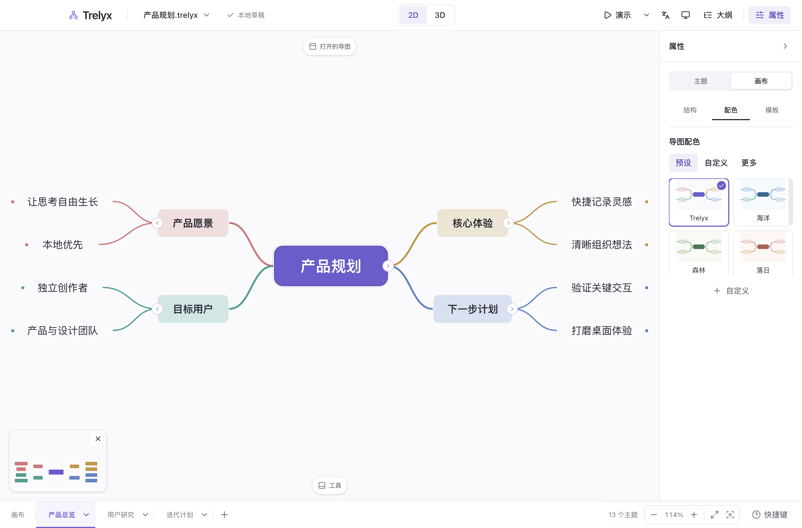
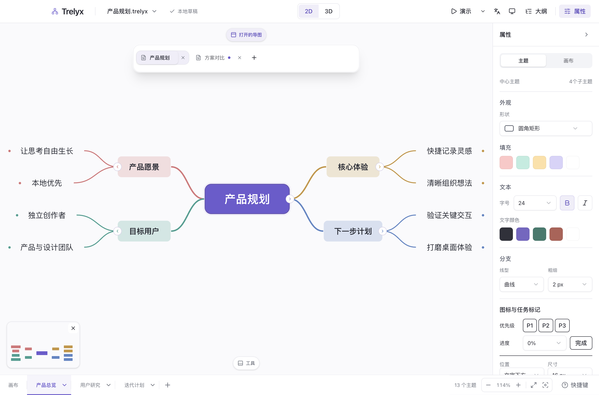
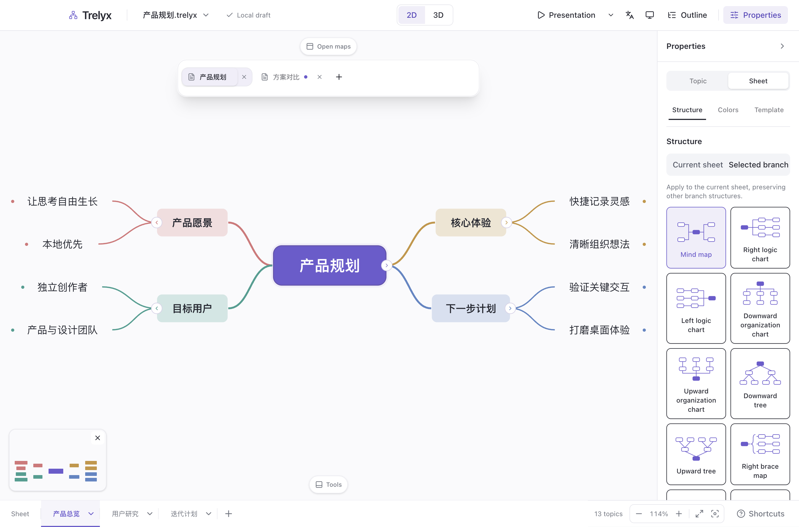
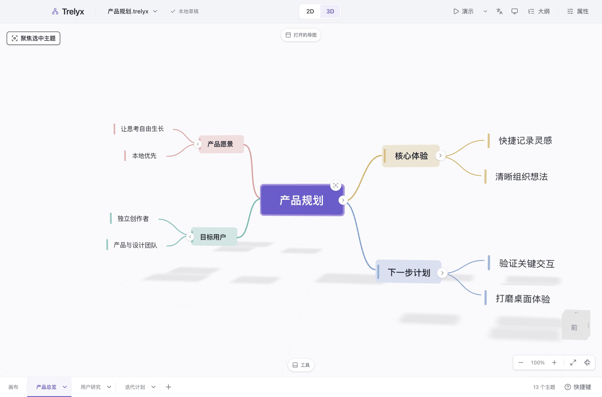

# 桌面工作区与多文档验收

本页保留更名前的桌面功能验收与截图，图片中的原应用名称属于历史记录。Brainstorming 改名及新格式验证见 [更名记录](docs/rename.md)。

日期：2026-10-17。范围：属性侧栏横向分类、标题栏演示入口、顶部浮动文档标签、中文与英文、Electron 系统能力、DI 与 SQLite，以及依赖和 shadcn 更新。

此前外观与导图配色记录见 [历史验收](docs/design/appearance-qa.md)。

## 本轮变化

- 属性栏使用 shadcn 横向 Tabs：主题内容、格式与标记留在主题属性，结构、配色与模板放入画布属性。底部 Dock 保留画布操作；演示播放与设置移至标题栏。
- 顶部浮动标签支持最多 32 份导图。每份导图独立保留路径、历史、当前 Sheet 和二维/三维会话；关闭最后一份返回首页。同路径或工作簿 ID 会复用已有标签。
- 中文、英文即时切换，并由 SQLite 记住选择；原生菜单和启动窗口使用同一语言设置。文档标题、备注等用户内容不翻译。
- 该次历史验收中，文件、系统剪贴板与工作区恢复由 Electron main 管理，Inversify 组装服务；当时使用 Drizzle + better-sqlite3 保存语言、最近文件和恢复索引，正文使用原生 ZIP，密码不写入元数据库。当前 SQLite/Kysely/SQLCipher 实现见 [文件协议](docs/file-format.md)。
- 产品仅运行于 Electron。Playwright 使用真实桌面窗口、preload、主进程文件操作及隔离的本机存储；Storybook 的浏览器仅用于组件预览与测试。

## 环境与工具链

本机 macOS arm64，Node.js 24.22、pnpm 10.12.1、Electron 44.9、React 19.3.1。项目 Node 约束为 `>=24`，依赖仍遵循各自 engine；其它操作系统的原生行为尚未在实体系统验证。

TypeScript 7 使用官方并行安装方案，旧编译器 API 由官方 TypeScript 6 兼容包提供。React Compiler 1.0 在 renderer 和 Storybook 中启用；生产产物包含 memo cache。组件翻译显式绑定 react-i18next 的响应式 `t`，不依赖全局翻译函数刷新文案。

全部直接依赖已核对最新稳定版本；shadcn 使用固定官方 CLI 4.22.0 刷新，原始下载组件不维护业务补丁。另在空目录使用冻结锁文件完成离线安装（`--ignore-scripts`），验证依赖解析与 TypeScript 并行方案不依赖已有 node_modules；Electron 安装和原生模块另由桌面运行及打包检查验证。

## 验证

| 检查                     | 结果                                                                                          |
| ------------------------ | --------------------------------------------------------------------------------------------- |
| 格式、ESLint、TypeScript | 通过；提交钩子再次执行                                                                        |
| 单元与集成测试           | 84 个文件，708 项通过，包含真实 SQLite、恢复事务、密钥隔离、DI 释放及多文档会话               |
| Electron UI              | 100 个唯一用例均有通过记录；首轮 92/100，修正旧浏览器与单文档测试假设后，受影响 36 项全部通过 |
| 最后两处界面修正         | 拖动计数 4 项、语言即时切换与英文溢出及结构操作 4 项通过                                      |
| Storybook                | 18 个文件、62 项通过；结构名称换行后另复测结构交互通过                                        |
| 生产与 Storybook 构建    | 通过，保留 React Compiler                                                                     |
| macOS 预览包             | 打包及 `test:packaged` 通过：真实 ASAR 主页、新建、隔离 SQLite、原生 ZIP 保存与正常退出       |

桌面用例覆盖原生文件保存与真实关闭重开、XMind 转换、图片附件、中文输入与选区、二维/三维拖动、主题、演示、标签独立历史、重启恢复、密码与原生剪贴板。语言测试同时验证英文长名称卡片和整个结构区域没有横向溢出。

产物回归发现并修复了 Inversify 自动 peer 未被打包的问题：显式将 `reflect-metadata` 加入生产依赖。新增的正式包启动用例已加入 macOS CI，在打包后执行；它验证用户数据目录的真实路径，保存后正常退出，并检查模块加载错误。

最终构建在空闲 CPU/GPU 下采样，renderer 实际尺寸为 1440×949。以下包含原生文件操作、解析和自动化等待，不等同于纯布局耗时。原始三次数据见 [性能记录](docs/design/desktop/performance.json)。

| 主题数 | 三次打开耗时中位数 | 实际挂载主题数 |
| ------ | ------------------ | -------------- |
| 100    | 255.6 ms           | 100            |
| 1,000  | 681.0 ms           | 195–208        |
| 5,000  | 2,593.6 ms         | 195–208        |

## 真实桌面截图

以下来自 Electron 生产构建，已逐张查看。英文长名称已换行，导图内的中文用户内容保持原样。

## 限制

- macOS 产物为未签名、未公证的本地预览包，仍使用默认 Electron 图标。
- 性能采样只比较固定文档打开流程，不代表输入延迟、内存峰值或长期稳定性已完成验证。
- 部分底层错误仍可能显示中文；第三方线上 AI 服务与实体麦克风权限未纳入本轮本地回归。
